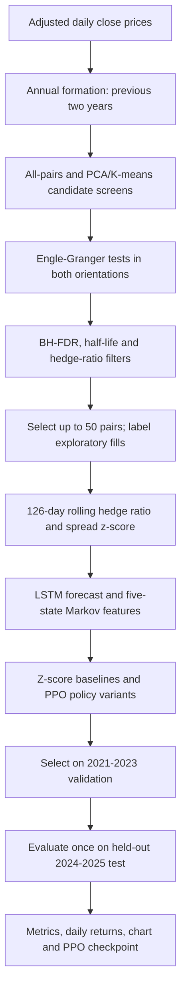
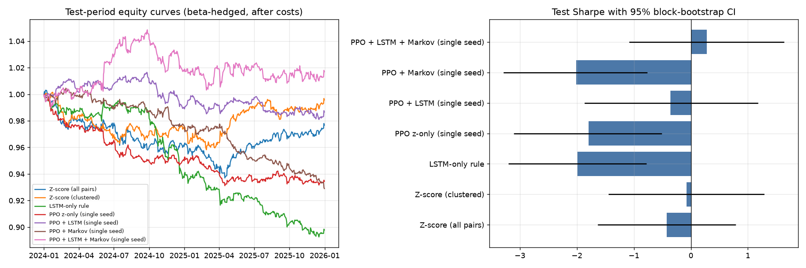

# Adaptive Pairs Trading on Indian Stocks (NSE)

An academic research project for screening Indian equities for candidate pairs, building mean-reverting spread signals, and comparing a z-score baseline with LSTM, Markov-state, and Proximal Policy Optimization (PPO) strategies. The pipeline uses chronological walk-forward evaluation and writes its metrics, pair-selection ledger, chart, and selected PPO checkpoint to disk.

> **Research use only.** This is a historical backtest, not an investment recommendation or a production trading system. The reported fast-run result is preliminary and is not evidence of a reliable trading edge.

## Project contents

| Path | Description |
| --- | --- |
| `pairs_pipeline.py` | Executable end-to-end research pipeline. |
| `pairs_trading_final_model.ipynb` | Notebook version for interactive/Kaggle use. |
| `sync_notebook.py` | Regenerates the notebook cells from the pipeline while preserving its initial notebook setup cell. |
| `prepare_public_dataset.py` | Downloads the pinned upstream files and builds the local adjusted-close CSV. |
| `data/README.md` | Dataset schema, provenance, local setup, and redistribution note. |
| `outputs/full_fast/` | Saved full-profile fast-run metrics, test return series, chart, manifests, and selected PPO model. |
| `outputs/README.md` | Guide to generated output files and the saved model artifact. |

## Workflow



## Method summary

1. **Universe and annual formation.** The full profile uses 57 present-day NSE tickers with adjusted daily closes from 2012-01-02 through 2025-12-31. For each trading year, pair formation uses only the previous two years of observations.
2. **Pair screening.** The baseline checks all pairs. The clustered screen standardizes returns, applies PCA and K-means, and tests within-cluster pairs. The Engle-Granger test is evaluated in both stock orientations; the smaller p-value is corrected across that year's candidates using Benjamini-Hochberg FDR. The statistical screen also requires an estimated half-life of 3–60 trading days and hedge-ratio magnitude above 0.1. Pair overlap is capped at four pairs per stock. The annual target is 50 pairs; when fewer pass all filters, eligible fills are marked **exploratory**.
3. **Spread signals and trading rules.** A 126-trading-day rolling regression estimates the hedge ratio and spread z-score. Entry/exit rules are tuned on 2019-2020 only. Positions are set using information through close *t* and evaluated on the return to close *t+1*. The backtest charges 20 basis points per unit of combined two-leg turnover and applies a 5% per-stock gross-exposure cap.
4. **Forecast and policy variants.** An LSTM uses 20-day sequences to forecast normalized five-day spread return. A five-state Markov model estimates five-day state probabilities from past pair-years. PPO chooses target spread exposure from `{-1, -0.5, 0, 0.5, 1}`. The comparison also includes all-pairs and clustered z-score rules, an LSTM-only rule, and PPO feature variants.
5. **Chronological evaluation.** The full profile trains on 2017-2020, selects models using 2021-2023 validation, and evaluates on the untouched 2024-2025 test period. The included `full_fast` run uses one PPO seed, 12,000 PPO steps, and three LSTM epochs. The configured full run uses three seeds, 150,000 PPO steps, and 15 LSTM epochs.

## Dataset and provenance

The source repository describes its terms as non-commercial research/personal use and restricts redistribution. Therefore, this repository **does not include the adjusted-price CSV files**. It includes a pinned download-and-format recipe instead. Read [`data/README.md`](data/README.md) and the [upstream license at the pinned commit](https://github.com/aswinv90/indian-market-historical-data/blob/bbe90ca7fb2a3d1ceb47ccaa158e12e81b9cfb40/LICENSE) before using the source data.

To create the local 57-stock CSV, run `prepare_public_dataset.py` after installing the requirements. The generated files are ignored by Git. The separate 12-stock CSV used for an exploratory compact run is also excluded because its original data source could not be verified.

The fixed universe contains stocks selected from present-day names rather than historical constituent snapshots. This creates survivorship bias. The pipeline accepts point-in-time membership data using `MEMBERSHIP_CSV`, but no such snapshots are included.

## Setup and run

Use Python 3.11 or newer. In PowerShell from the repository root:

```powershell
py -3.11 -m venv .venv
.\.venv\Scripts\Activate.ps1
python -m pip install --upgrade pip
python -m pip install -r requirements.txt
python prepare_public_dataset.py

$env:DATA_SOURCE = 'csv'
$env:PRICE_CSV = 'data/public_nse_adjusted_2012_2025.csv'
$env:END_DATE = '2025-12-31'
$env:PROFILE = 'full'
$env:FAST = '1'
$env:OUT_DIR = 'outputs/full_fast'
$env:MPLBACKEND = 'Agg'
python pairs_pipeline.py
```

Set `FAST` to `0` for the configured training budget. To use another properly licensed CSV, set `DATA_SOURCE='csv'` and `PRICE_CSV` to its path. The input format is a `Date` column followed by one adjusted-close column per ticker, such as `RELIANCE.NS`. The default pipeline source is `yfinance`; synthetic data is for code smoke checks only and should not be used for reported performance.

The notebook can be opened in Jupyter or Kaggle. In Kaggle, internet access is needed for online data downloads. After changing the Python pipeline, run `python sync_notebook.py` to refresh its notebook cells.

## Saved full-profile fast-run results

These are the saved 2024-2025 held-out results in [`outputs/full_fast/results_table.csv`](outputs/full_fast/results_table.csv) and [`outputs/full_fast/test_daily_returns.csv`](outputs/full_fast/test_daily_returns.csv). Cumulative return is compounded from the saved daily test returns. Sharpe intervals are 95% block-bootstrap intervals.

| Strategy | Cumulative test return | Test Sharpe (95% block-bootstrap CI) | Annualized return | Maximum drawdown |
| --- | ---: | ---: | ---: | ---: |
| PPO + LSTM + Markov (selected validation variant) | +1.70% | 0.282 `[-1.082, 1.632]` | +0.86% | -4.32% |
| Z-score, clustered pairs | -0.43% | -0.079 `[-1.448, 1.284]` | -0.22% | -4.32% |
| PPO + LSTM | -1.34% | -0.360 `[-1.864, 1.176]` | -0.68% | -3.50% |
| Z-score, all pairs | -2.32% | -0.426 `[-1.636, 0.790]` | -1.19% | -6.58% |
| PPO z-only | -6.55% | -1.797 `[-3.107, -0.515]` | -3.39% | -6.88% |
| PPO + Markov | -7.10% | -2.016 `[-3.287, -0.767]` | -3.68% | -7.53% |
| LSTM-only rule | -10.22% | -1.992 `[-3.205, -0.783]` | -5.34% | -10.74% |

The validation-selected PPO + LSTM + Markov variant has the best point estimate in this run, but its Sharpe interval includes zero. It returned approximately +1.70% over the two-year test, equivalent to about **₹1,696 on a hypothetical ₹100,000 starting notional** under the backtest assumptions. The point estimate is small, the run uses one seed, and the result should not be described as a robust positive edge.



## Backtest assumptions and limitations

- Short carry is set to zero. The backtest does not model futures basis, margin, taxes, or market impact; Indian cash-market shorting constraints also make overnight short legs a practical limitation.
- The 20 bps cost is a configurable estimate applied to combined two-leg turnover, not a broker-specific execution simulation.
- The log-price hedge ratio creates a beta-hedged spread and is not necessarily dollar neutral.
- Of 1,200 selected pair-year slots across both methods and all formation years, only 41 passed both the FDR and half-life screens; 1,159 were exploratory fills. Neither selector had a pair pass the FDR screen in 2024 or 2025. Review `selection_counts.csv` before interpreting portfolio returns as evidence about cointegration.
- The fast run has one seed and reduced training budgets. Re-run with the full settings and independently validate the implementation and input data before drawing conclusions.

For details on each saved file and the checkpoint format, see [`outputs/README.md`](outputs/README.md).
